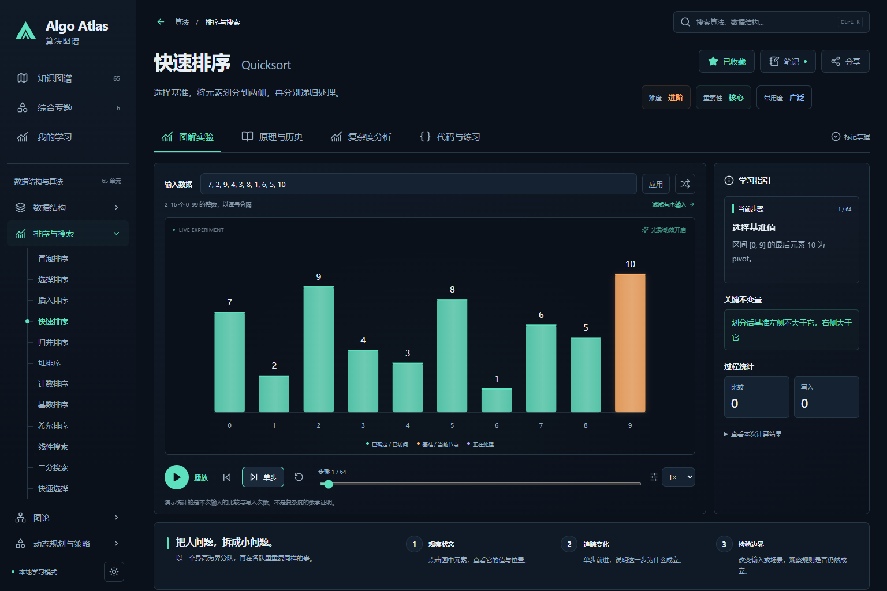

# Algo Atlas · 算法图谱

**理解比记住更重要。** 一个中文优先、可交互的算法与数据结构教学工作台。

79 个学习单元 · 9 个综合专题 · 37 道带题解训练 · React + TypeScript · MIT



## 用它做什么

- 在分层目录中搜索中文名称、英文名称和用途，按难度、重要性、常用度挑选课程。
- 用真实算法状态播放、暂停、逐步前进/后退、调速、拖动时间轴，修改输入并比较结果。
- 连线以加速传导和光粒进入、逆向收束退场；节点惯性换位、柱体扫光、矩阵数值过渡。可关闭光影并自动尊重系统减少动态效果。
- 从类比和不变量出发，了解原理、发展背景、用途、复杂度前提、工程误区与进阶知识。
- 比较最好/平均或期望/最坏时间与空间；交互增长图明确使用对数纵轴，而非伪造性能跑分。
- 每课在同一页连续展示实验、原理与历史、复杂度、多语言实现和练习；页内导航只滚动定位，播放不会推动其他章节。
- 全部 79 课提供简洁伪代码、JavaScript ES2022 / Python 3 独立核心实现、接口约定和可运行样例；保留 TypeScript 实验引擎源码入口。
- 从当前课程进入练习库自动筛选该课程，未有独立题目的课程明确提示；每课仍有理解题和实验任务。
- 收藏、笔记与完成状态保存在本机；可导出、合并导入 JSON 备份。分享可还原课程、输入、目标与步骤，不包含私人笔记。
- 桌面与手机响应布局，深浅主题，键盘焦点与对话框焦点管理，尊重减少动画设置。

## 本地运行

建议 Node.js 22.12+（或更高的受支持版本）、npm。开发测试另需 Python 3.10+（CI 使用 3.12）来实际执行 Python 教学代码；普通网页运行不需要 Python。

```powershell
git clone https://github.com/ax2/algo-atlas.git
cd algo-atlas
npm ci
npm run dev
```

打开 `http://127.0.0.1:5173`。Windows 也可双击 `START.cmd`。

```powershell
npm run check              # 算法性质/存储校验测试 + 类型检查 + 生产构建
npx playwright install chromium
npm run test:e2e           # 桌面/移动 Chromium 功能回归
npm run preview           # 预览 dist 生产产物
```

应用使用 hash 路由和相对资源路径，可部署到子目录静态托管。无需服务端路由回退。生产页面不依赖外部字体、CDN 或第三方分析。

## 覆盖范围

| 分类 | 单元数 | 代表内容 |
| --- | ---: | --- |
| 数据结构 | 25 | 数组、链表、栈/队列/双端队列、哈希表、BST、AVL、红黑树、堆、Trie、并查集、树状数组、线段树、跳表、B 树、布隆过滤器、LRU、图存储、Treap、Splay、懒标记/可持久化线段树、稀疏表、k-d 树 |
| 排序与搜索 | 12 | 冒泡、选择、插入、快速、归并、堆、计数、基数、希尔、线性/二分搜索、快速选择 |
| 图论 | 11 | BFS、DFS、Dijkstra、Bellman–Ford、Floyd、拓扑排序、Kruskal、Prim、A*、SCC、最大流 |
| 动态规划与策略 | 12 | 前缀和、双指针、滑动窗口、单调栈、记忆化、背包、零钱兑换、LCS、编辑距离、LIS、回溯、贪心 |
| 字符串 | 6 | 朴素匹配、KMP、Rabin–Karp、Z 函数、后缀数组、Huffman |
| 数学与几何 | 5 | GCD、埃氏筛、快速幂、位掩码子集、凸包 |
| AI 与机器学习 | 8 | 梯度下降、K-means、kNN、感知机、CART、反向传播、缩放点积注意力、Minimax/α–β |

完整模式和能力边界见 [覆盖清单](docs/coverage.md)。这是一个明确的常见主题覆盖基线，**不是“穷尽所有算法”的声明**。图与复杂树采用精选可切换场景；删除、任意图编辑和全部数据结构操作尚非本版本范围。每项都有真实计算或机制轨迹，未用通用假动画填充目录。

## 讲解模式与练习库

图解实验以一屏实验台呈现：图形按节点、标签和连线的实际边界居中放大，矩阵按表格本身的大小适配；播放控制固定在底部，没有内部滚动条。树/字符串等需要输入参照的课程，将原文或构建序列放在画布内；普通图算法直接呈现图，不重复堆叠输入边列表。队列、栈、缓冲区和桶按实际状态显示在画布底部，长列表可翻页。讲解分为“这一步 / 详解 / 数据 / 结果”，说明、码表与结果根据真实字体、换行、表格行高及可用空间合并排版；只有放不下时才分页，窗口变化后自动重新分页。全部原始输入仍可在“数据”中核对。关键节点用下拉导航跳转，讲解模式自动暂停；支持浏览器全屏专注模式。Huffman 从建树一直演示到码表、原文编码与逐位解码。

独立练习库提供 37 道原创题：24 道竞赛/结构训练、13 道 AI 数值训练。支持类型、难度、专题、关键词、完成状态筛选和分页；每题有提示、样例、完整题解、正确性说明、复杂度与经过测试的 TypeScript 参考实现。自评完成状态随学习备份保存；不提供在线判题或用户代码执行。

Stage 003 审查修复了 AVL/LLRB 局部树丢失与错误染色、线段树提前连边、链表节点身份、SCC 反图方向及数处实现/复杂度不一致。详细证据见 [阶段日志](docs/iterations/stage-003-teaching-audit.md)。

Stage 005 复查全目录的逐帧结构和结果，修复拓扑队列显示，补充 Huffman 编解码、堆弹出下沉、线段树查询、真正的递归记忆化，以及持久化路径复制过程。双语言实现与动画可能采用不同变体，其输入范围与成本单独列出；参见 [单页课程与实现日志](docs/iterations/stage-005-implementations.md)。Stage 006 重新设计单屏实验台，参见 [布局与验证记录](docs/iterations/stage-006-single-screen.md)。Stage 007 进一步优化实际图形边界与按可用高度分页，参见 [自适应内容布局](docs/iterations/stage-007-adaptive-content.md)。

## 九个综合专题

1. **城市里的最短一程**：同图比较 BFS 跳数与 Dijkstra 权重代价。
2. **一次请求的缓存之旅**：布隆预筛 → LRU → 回源，调容量、换访问序列。
3. **把混乱任务排成秩序**：依赖环检测、拓扑序与独立区间调度的边界。
4. **有限预算，如何选得更好**：价值密度贪心与 0/1 DP 同输入比较。
5. **做一个懂前缀的搜索器**：前缀检索、正文匹配和索引选择。
6. **两段文字之间发生了什么**：LCS、编辑距离与仅插入删除成本对比。
7. **让一个神经网络真正学起来**：2→3→1 MLP，XOR/AND、前向、平均交叉熵、反向自动微分与全批量 SGD。
8. **走进 Transformer 的一次训练**：单层双头因果块，嵌入/位置、QKV、掩码、残差/Pre-LN/FFN、词表分布和 158 个参数的梯度更新。
9. **让智能体从试错中找到路线**：3×4 网格 Q-learning，ε-greedy、环境反馈、TD 目标、Q 表更新和独立贪心评估。

三个 AI 实验可修改场景、学习率与轮数；强化学习另可修改探索率与折扣。支持阶段跳转、自动暂停、损失/回报曲线、张量检查、参数更新账本和设置/步骤分享。每个专题配 3 道带答案练习。所有数值来自真实小模型计算，有限轮次不保证收敛；不是完整大模型或深度强化学习训练平台。详见 [Stage 004](docs/iterations/stage-004-ai-labs.md)。

## 设计与工程

```text
src/content/       版本化课程、分级和综合专题
src/engine/        纯函数轨迹计算；不可变帧与结果
src/components/    实验播放器、图、课程内容和工作台页面
src/services/      本地学习仓库、验证、备份合并、路由、未来 HTTP 适配器
tests/             算法性质与跨算法对照；可复现浏览器回归
docs/              计划、设计、架构、服务契约、覆盖、阶段记录
```

新增课程需同时提供内容、实际轨迹、输入限制、结果 oracle 和复杂度条件，详见 [贡献指南](CONTRIBUTING.md)。

## 在线服务预留

目前无需登录，本地功能完整可用。`OnlineLearningService` / `HttpLearningService` 预留同源 `/api/v1/me` 与 `/api/v1/learning`，支持版本号与 `If-Match` 冲突语义，见 [服务契约](docs/online-services.md)。

**账号、云端存储、跨设备同步尚未部署。** 不显示假登录或假同步状态。启用前应实现身份认证、授权、CSRF 防护、服务器数据验证、限流、备份与隐私政策。任何密钥都不能放进 `VITE_*` 环境变量。

## 教学与验证边界

难度、重要性与常用度是编辑判断，不是实时流行榜。历史采用保守概述，基础技术不强行归于一个发明者。教材入口见 [资料说明](docs/sources.md)。

可视化引擎为回放保存帧，其内存开销不等于算法本身空间；实验小规模实现与生产优化版本不同处均在课程中说明。例如 A* 使用 h=0 基线、Prim 扫描边、Huffman 线性取最小、后缀数组显式后缀插入排序。算法测试不等于专业课程审定或真实移动设备验收。

MIT © 2026 ax2
